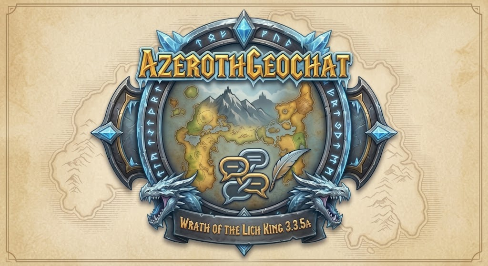

<p align="center">
  
</p>

# AzerothGeoChat (WoW 3.3.5a)

[-orange.svg)](https://wowpedia.fandom.com/wiki/TOC)
[](https://wowpedia.fandom.com/wiki/Build_12340)
[]()
[](LICENSE)
[-green.svg)]()

**AzerothGeoChat** არის სრულფასოვანი, მსუბუქი და zero-dependency AddOn-ი **World of Warcraft 3.3.5a**-სთვის (Wrath of the Lich King), რომელიც უზრუნველყოფს თამაშში ქართულ (მხედრულ) ენაზე სრულ კომფორტულ წერას, კითხვასა და შემომავალი ტრანსლიტის ავტო-თარგმნას.

პროექტში **უკვე ჩაშენებულია გამზადებული შრიფტების პაკეტი (`Fonts/`)**, ასე რომ მოთამაშეს არაფრის კონფიგურაცია არ სჭირდება — უბრალოდ ჩააგდეთ ფაილები თამაშის დირექტორიაში და ითამაშეთ!

---

## 📌 რატომ არის ეს AddOn საჭირო? (Technical Background)

1. **DirectX 9 / Windows კლავიატურის შეზღუდვა:** WoW 3.3.5a კლიენტი ვერ იღებს არასტანდარტულ (non-ANSI) Windows-ის ენობრივ განლაგებებს. როდესაც Windows-ში ჩართულია ქართული კლავიატურა, თამაშის ჩატის ველში იწერება კითხვის ნიშნები (`???`).
2. **შრიფტების (Font Glyphs) ნაკლებობა:** ოფიციალური ინგლისური (`enUS` / `enGB`) კლიენტის შრიფტებში ქართული უნიკოდის სიმბოლოები (`U+10D0`–`U+10FA`) არ არსებობს. შესაბამისად, ქართული ასოები თამაშში ჩანს როგორც კითხვის ნიშნები (`??????`).

**AzerothGeoChat** ამ პრობლემებს აგვარებს:
* **არ გჭირდებათ Windows-ში ენის შეცვლა:** Windows-ი რჩება ინგლისურზე (`EN`), თქვენ კრეფთ QWERTY ღილაკებით და ადონი მომენტალურად წერს ქართულად!
* **Shift-ის გარეშე წერა (Phonetic Digraphs):** აკრიფეთ `shemodi` და დაიწერება `შემოდი`, `chven` -> `ჩვენ`!
* **შემომავალი ჩატის თარგმნა:** სხვა მოთამაშეების ინგლისური ასოებით გამოგზავნილ ქართულ ტრანსლიტს ავტომატურად გადაიყვანს ლამაზ ქართულ მხედრულად!
* იცავს WoW-ის ბმულებს (Hyperlinks), ჩურჩულის სახელებს (Whisper Targets) და სისტემურ ბრძანებებს (`/cast`, `/target`, `/run` და ა.შ.).

---

## 🚀 ინსტალაციის ინსტრუქცია (სულ 2 ნაბიჯი)

გადმოწერეთ ეს რეპოზიტორი (`Code` -> `Download ZIP`) და ამოაარქივეთ:

### ნაბიჯი 1: AddOn-ის ჩაგდება
`AzerothGeoChat` საქაღალდე ჩასვით თამაშის AddOns დირექტორიაში:
```text
World of Warcraft/Interface/AddOns/AzerothGeoChat/
```

### ნაბიჯი 2: Fonts საქაღალდის ჩაგდება
პროექტში არსებული გამზადებული **`Fonts`** საქაღალდე პირდაპირ ჩააგდეთ თქვენი თამაშის მთავარ დირექტორიაში (სადაც `Wow.exe` დევს):
```text
World of Warcraft/Fonts/
```

> **მორჩა!** გაუშვით WoW და ჩატში ქართული შრიფტი მაშინვე გამართულად გამოჩნდება.

---

## ⌨️ კლავიატურის განლაგება (Keyboard Layout)

ადონი იყენებს სტანდარტულ ქართულ QWERTY განლაგებას:

| ლათინური | ქართული | ლათინური | ქართული |
|:---:|:---:|:---:|:---:|
| `a` | ა | `b` | ბ |
| `g` | გ | `d` | დ |
| `e` | ე | `v` | ვ |
| `z` | ზ | **`T`** (Shift+t) | **თ** |
| `t` | ტ | `i` | ი |
| `k` | კ | `l` | ლ |
| `m` | მ | `n` | ნ |
| `o` | ო | `p` | პ |
| **`J`** (Shift+j) | **ჟ** | `r` | რ |
| `s` | ს | `u` | უ |
| `f` | ფ | `q` | ქ |
| **`R`** (Shift+r) | **ღ** | `y` | ყ |
| **`S`** (Shift+s) | **შ** | **`C`** (Shift+c) | **ჩ** |
| `c` | ც | **`Z`** (Shift+z) | **ძ** |
| `w` | წ | **`W`** (Shift+w) | **ჭ** |
| `x` | ხ | `j` | ჯ |
| `h` | ჰ | | |

---

## ✨ ახალი ფუნქციები (v1.3.0 Features)

### 1. 🔥 ორმაგი ასოები Shift-ის გარეშე (Phonetic Digraphs)
აღარ არის საჭირო Shift-ის დაჭერა სპეციალური ასოების დასაწერად! უბრალოდ აკრიფეთ:
* **`sh`** ➡️ **`შ`** *(მაგ. `shemodi` ➡️ **შემოდი**)*
* **`ch`** ➡️ **`ჩ`** *(მაგ. `chven` ➡️ **ჩვენ**)*
* **`gh`** ➡️ **`ღ`** *(მაგ. `ghame` ➡️ **ღამე**)*
* **`zh`** ➡️ **`ჟ`** *(მაგ. `zhurnali` ➡️ **ჟურნალი**)*
* **`th`** ➡️ **`თ`** *(მაგ. `tavisupleba` / `thavisupleba` ➡️ **თავისუფლება**)*
* **`dz`** ➡️ **`ძ`** *(მაგ. `dzala` ➡️ **ძალა**)*
* **`ts`** ➡️ **`ც`**

### 2. 💬 შემომავალი ტრანსლიტის ავტო-თარგმნა (Incoming Translator)
თუ სხვა მოთამაშეები მოგწერთ ინგლისური ასოებით (მაგ. `"bichebo sad xart?"`), ადონი ჩატში ავტომატურად გაჩვენებთ გადათარგმნილ ტექსტს ქართული ასოებით: `"ბიჭებო სად ხართ?"`. ჩასართავად აკრიფეთ `/geo inc` ან მონიშნეთ პარამეტრებში.

### 3. ⚙️ თამაშშიდა პარამეტრების მენიუ (Options Panel)
გახსენით პარამეტრები ბრძანებით `/geo opt` ან თამაშის მენიუდან: `Escape` -> `Interface` -> `AddOns` -> `AzerothGeoChat`.
* ჩართვა / გამორთვა.
* ორმაგი ასოების (Digraphs) ჩართვა / გამორთვა.
* შემომავალი ტრანსლიტის თარგმნის ჩართვა / გამორთვა.
* ხმოვანი ეფექტები (Sound effects).
* [GEO] ღილაკის გამოჩენა / დამალვა.
* ღილაკის პოზიციის გადატვირთვის ღილაკი.

### 4. 🖱️ მოძრავი გადამრთველი ღილაკი (Draggable [GEO] Button)
* განთავსებულია უშუალოდ ჩატის ველის შიგნით, მარჯვენა კიდეზე.
* **Shift + Drag:** გეჭიროთ `Shift` და მაუსით გადააადგილეთ ღილაკი ეკრანზე ნებისმიერ ადგილას.
* **Left-Click:** სწრაფი ჩართვა / გამორთვა (მწვანე `[GEO]` / რუხი `[ENG]`).
* **Right-Click:** მიმდინარე აკრეფილი ტექსტის მყისიერი გადაყვანა (Latin <-> Geo).

---

## 🎮 ჩატის ბრძანებები (Slash Commands)

| ბრძანება | მოქმედება |
|---|---|
| **`/geo`** ან **`/geochat`** | ქართული შეყვანის ჩართვა / გამორთვა |
| **`/geo on`** / **`/geo off`** | იძულებით ჩართვა ან გამორთვა |
| **`/geo c`** ან **`/geo convert`** | მიმდინარე ველში აკრეფილი ტექსტის გადაყვანა (Latin <-> Geo) |
| **`/geo dg`** | ორმაგი ასოების (Digraphs: sh, ch, gh...) ჩართვა / გამორთვა |
| **`/geo inc`** | შემომავალი ტრანსლიტის თარგმნის ჩართვა / გამორთვა |
| **`/geo opt`** | პარამეტრების გრაფიკული მენიუს გახსნა |

---

## 📂 პროექტის სტრუქტურა (Project Structure)

```text
AzerothGeoChat/
├── banner.png                  # სარეპოზიტორო ბანერი
├── geo.jfif                    # ორიგინალი ბანერი
├── AzerothGeoChat/             # AddOn-ის საქაღალდე (მიდის Interface/AddOns/-ში)
│   ├── AzerothGeoChat.toc      # AddOn-ის მეტამონაცემები (Interface 30300)
│   ├── AzerothGeoChat.lua      # ძირითადი კოდი და ლოგიკა
│   ├── Bindings.xml            # Keybindings დეფინიციები
│   └── Fonts/                  # შიდა შრიფტების სარეზერვო საქაღალდე
├── Fonts/                      # გამზადებული შრიფტები (მიდის World of Warcraft/-ში)
│   ├── ARIALN.ttf
│   ├── FRIENDS.ttf
│   ├── FRIZQT__.ttf
│   ├── MORPHEUS.ttf
│   └── skurri.ttf
├── Install-Fonts.ps1           # ფონტების ავტომატური ინსტალატორი (PowerShell)
├── README.md                   # დოკუმენტაცია
├── LICENSE                     # MIT ლიცენზია
└── .gitignore                  # Git-ის იგნორირების ფაილი
```

---

## 📜 License

This project is licensed under the [MIT License](LICENSE).  
Author: **Azeroth Reborn**
